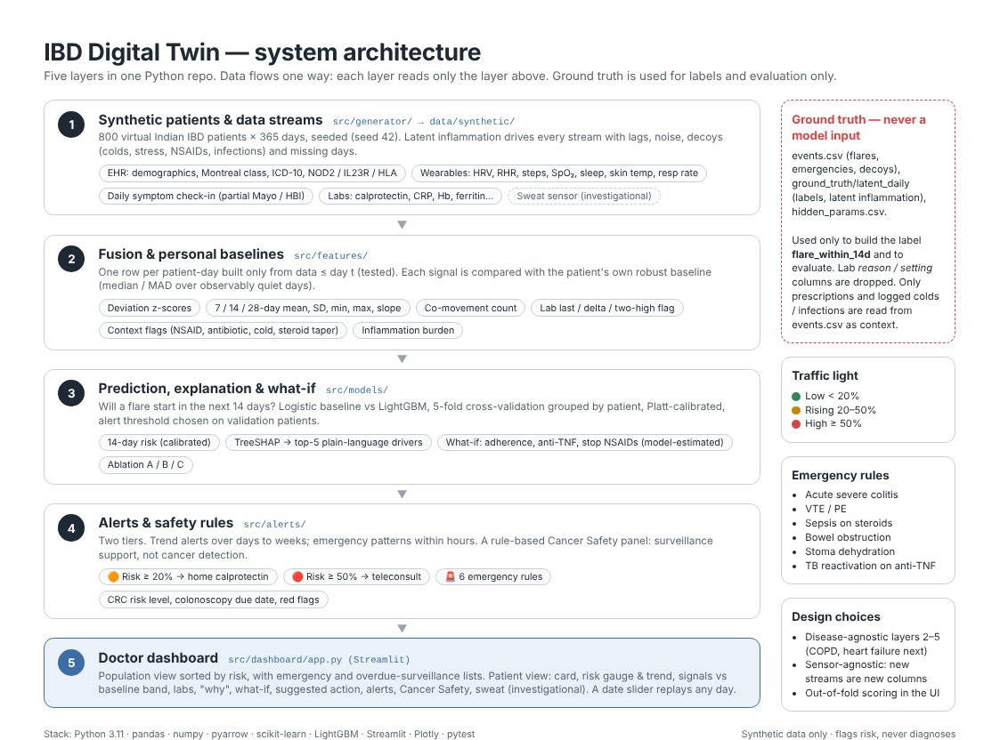
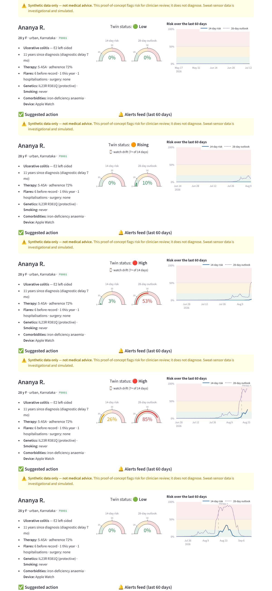

# IBD Digital Twin — predicting inflammatory bowel disease flares weeks ahead

> ⚠️ **Synthetic data only — not medical advice.** Every patient in this repository is simulated (DPDP Act / HIPAA sandbox rules). The twin flags risk for clinician review; it never diagnoses. The sweat-sensor stream simulates an investigational technology.

Submission for the **Happiest Health *Reimagining and Reforming Healthcare in India Summit 2026*** (Bengaluru) — Digital Twin Challenge 2026, Prototype & Code Submission.

## Submission checklist

| Required item | Where |
|---|---|
| Team details | [Team details](#team-details) |
| College / incubator information | [College / incubator information](#college--incubator-information) |
| Project title | [Project title](#project-title) |
| Problem statement | [Problem statement](#problem-statement) |
| Healthcare use case | [Healthcare use case](#healthcare-use-case) |
| Technical stack | [Technical stack](#technical-stack) |
| AI/ML model or framework details | [AI/ML model and framework details](#aiml-model-and-framework-details) |
| Demo video (15–20 min, unlisted YouTube) | [Demo video](#demo-video) |
| Open-source licence | [Open-source licence](#open-source-licence) · [`LICENSE`](LICENSE) |
| Architecture diagram (PDF / PPT) | [Architecture diagram](#architecture-diagram) · [`docs/architecture.pdf`](docs/architecture.pdf) · [`docs/architecture.pptx`](docs/architecture.pptx) |
| Presentation (PDF / PPT) | [Presentation](#presentation-pdf--ppt--project-details-and-outcomes) · [`docs/presentation.pdf`](docs/presentation.pdf) · [`docs/presentation.pptx`](docs/presentation.pptx) |
| Public access | [Access](#access) |

## Team details

| Role | Name | Roll No. | Programme | Email | Phone |
|---|---|---|---|---|---|
| **Team Leader** | **Prantik Sarkar** | `2026PGP221` | PGP 2026–28 (MBA) | `prantik.pgp26@iimshillong.ac.in` / `prantikstrat21@gmail.com` | `+91-7278072814` |
| **Team Member** | **Swapnil Ghatak** | `2026PGP259` | PGP 2026–28 (MBA) | `swapnil.pgp26@iimshillong.ac.in` / `swapnilghatak@gmail.com` | — |

- **Team Name:** **`prantik.pgp26`**
- **Submission Folder Name:** **`prantik.pgp26_IIM_Shillong`**
- **GitHub Repository:** **`https://github.com/Prodman-PS/prantik.pgp26_IIM_Shillong`**

## College / incubator information

- **College:** **Indian Institute of Management Shillong (IIM Shillong)**, Umsawli, Shillong, Meghalaya – 793018, India
- **Incubator:** Not applicable

## Project title

**IBD Digital Twin: a virtual patient that predicts inflammatory bowel disease flares weeks ahead by fusing EHR data with smartwatch signals**

## Problem statement

**Inflammatory bowel disease (IBD)** — ulcerative colitis (UC) and Crohn's disease (CD) — is a lifelong, relapsing-remitting inflammation of the gut. There is no cure; care is about keeping patients out of flares.

India's burden is large and rising fast:

- About **1.4 million patients** (2010 estimate), the largest IBD population in Asia (*Pivot to Asia*, Kedia & Ahuja). India is in the **"acceleration in incidence" stage** (*Nature* 2025).
- It hits people aged **20–40**. The median diagnostic delay is **15 months**, costing a median **₹1,36,029 (5.5× monthly household income)** (*Indian J Gastroenterol*).
- **It's not just a city disease.** There is no rural–urban difference among 30,000+ symptomatic patients (AIG study), but specialists are concentrated in tier-1 cities.

Today, care is **reactive**: the patient travels to a specialist after the flare has hit. Yet the signs show up much earlier:
- Smartwatch HRV falls and resting heart rate rises **up to 7 weeks before a flare**, with F1 up to 0.90 (Hirten et al., Mount Sinai, *Gastroenterology* 2025).
- Stool calprotectin rises **about 3 months before** UC relapse (Antwerp).

No one has combined these signals into a digital twin a doctor can use.

## Healthcare use case

**Who:** a gastroenterologist managing IBD patients between visits. Patients include rural ones far from a specialist.

**Data:** passive, from the patient's smartwatch, a 30-second daily symptom check-in in an app, periodic labs and an occasional home stool calprotectin test.

**What the doctor gets:**
1. Every patient sorted by flare risk.
2. A 14-day flare probability and a 28-day outlook, with the reasons in plain words.
3. Watch-drift alerts that trigger a home calprotectin test before symptoms appear.
4. Emergency alerts within hours: acute severe colitis, blood clot, sepsis on steroids, bowel obstruction, stoma dehydration, TB reactivation on anti-TNF.
5. A what-if simulator for therapy changes.
6. A Cancer Safety panel so no high-risk patient misses a surveillance colonoscopy.

**Outcome:** teleconsult the right patient weeks before a flare instead of treating it after a hospital visit. It's a *blood-pressure cuff for gut inflammation*.

## Demo video

**▶ [Watch the 27-Minute Prototype & Presentation Video (Unlisted YouTube: https://youtu.be/zaEuDdV3grc)](https://youtu.be/zaEuDdV3grc)**

Running order and script: [`docs/video_script.md`](docs/video_script.md).

## Open-source licence

Released under the **MIT Licence** ([`LICENSE`](LICENSE)). This covers all code, the synthetic dataset, the trained model files and the documents in `docs/`. The third-party libraries keep their own licences: pandas, numpy, scikit-learn and pyarrow (BSD-3-Clause); LightGBM (MIT); Streamlit and Plotly (Apache-2.0 / MIT).

## Access

The repository is public. Every file and link in this README opens without sign-in or extra permissions:
- The architecture diagram, presentation and screenshots are committed in `docs/`.
- The video is an unlisted (not private) YouTube link.

## What the twin does

| | Digital-twin function | In this prototype |
|---|---|---|
| **Mirror** | A live copy of the patient against their *own* baseline | Fuses EHR + wearables + symptoms + labs into one row per patient-day, comparing each signal with the patient's personal median / MAD on quiet days |
| **Predict** | Adverse event in advance | **P(flare onset within 14 days)** — the evaluated target — plus a 28-day outlook, calibrated, with alerts |
| **Explain** | Why the risk is high | SHAP top-5 drivers in plain words ("Resting HR +5.4 bpm vs baseline (64 → 69)") |
| **Simulate** | What-if before acting | Re-scores today with adherence 100%, anti-TNF or no NSAIDs (labelled *model-estimated*) |
| **Protect** | Emergencies and cancer safety | 6 emergency rules (hours-level) and a rule-based Cancer Safety panel (colonoscopy due dates, red flags) |

## Architecture diagram



**PDF: [`docs/architecture.pdf`](docs/architecture.pdf) · PPTX: [`docs/architecture.pptx`](docs/architecture.pptx) · PNG: [`docs/architecture.png`](docs/architecture.png)**

## Presentation (PDF / PPT) — project details and outcomes

**PDF: [`docs/presentation.pdf`](docs/presentation.pdf) · PPTX: [`docs/presentation.pptx`](docs/presentation.pptx)**

15-slide presentation deck covering:
1. **Title & Overview:** *IBD Digital Twin — Predicting inflammatory bowel disease flares weeks before they hit* (`prantik.pgp26 · IIM Shillong`)
2. **The Burden:** ~1.4M IBD patients in India (largest in Asia), peak age 20–40, 15-month median diagnostic delay costing 5.5× monthly household income (₹1.36 lakh), rural–urban parity vs tier-1 specialist concentration
3. **The Opportunity:** 7-week smartwatch HRV/RHR/step pre-flare lead time (*Gastroenterology* 2025) + 3-month faecal calprotectin lead time (Antwerp cohort)
4. **The Solution:** Mirror, Predict (14-day risk + 28-day outlook), Simulate (What-if therapy re-scoring), and Protect (6 emergency rules + BSG 2019 Cancer Safety surveillance)
5. **System Architecture:** 5-layer one-way causal pipeline (`src/generator` → `src/features` → `src/models` → `src/alerts` → `src/dashboard`) with strict ground-truth isolation
6. **The Synthetic Cohort:** 800 virtual Indian IBD patients × 365 days (seed 42) with 1,562 colds, 2,234 stress weeks, 565 NSAID courses, 286 gut infections, and realistic missingness
7. **Method:** Personal quiet-day baselines (median/MAD), 290 causal rolling features, LightGBM vs Logistic regression, 5-fold patient-grouped CV, Platt calibration
8. **Results on Held-Out Patients:** PR-AUC **0.881** (vs 0.844 logistic), AUROC **0.995**, **99.3% of flare onsets caught** (408/411), **15-day median lead time** (20 days on 28-day outlook), **0.038 false alarms / patient-month**
9. **Stream Ablation (Models A–E):** Watch + EHR alone catches 68% of flares passively; home calprotectin lifts to 90% (PR-AUC 0.731); 30-second daily check-in reaches 99% (PR-AUC 0.881)
10. **Patient Story (`P0001` Ananya, 28, Bengaluru):** Week 1 Low → Week 4 Rising watch drift → Week 5 High (`310 µg/g` calprotectin, `53%` outlook) → Week 6 therapy optimised → Week 9 flare averted
11. **The Doctor Dashboard:** Population triage view, 10-panel Patient view, plain-English TreeSHAP drivers, What-if simulator, and longitudinal date replay
12. **Safety Nets:** 6 hours-level emergency rules (< 0.005% false-alarm rate) and multi-year BSG 2019 colorectal cancer surveillance tracker
13. **India Pathway:** Consumer smartwatches + ₹800 home calprotectin today → ethics & DPDP Act clinical pilot / CDSCO SaMD pathway next → investigational sweat sensors & COPD/heart-failure expansion later
14. **Honest Limits:** Synthetic data caveats, non-causal What-if re-scoring, non-specific wearable signals, lab confounders, and clinical validation requirements
15. **Summary & Outcomes:** Flares caught weeks ahead, emergencies flagged within hours, no missed surveillance colonoscopy

There are five layers in one Python repo, and data flows one way:

1. **Synthetic patients and streams** (`src/generator/`, already provided). 800 patients × 365 days, seed 42. Details in [`docs/data_generator.md`](docs/data_generator.md).
2. **Fusion and personal baselines** (`src/features/`). 290 causal features per patient-day.
3. **Prediction, explanation, what-if** (`src/models/`). Logistic baseline + LightGBM, grouped 5-fold CV, Platt calibration, TreeSHAP.
4. **Alerts and safety rules** (`src/alerts/`). Trend alerts, emergency rules, Cancer Safety.
5. **Doctor dashboard** (`src/dashboard/app.py`, Streamlit).

**Ground truth never reaches the model.** `events.csv` and `ground_truth/` are used only to build labels and to evaluate. The lab `reason` / `setting` columns are dropped, because values like `"sepsis"` or `"twin_escalation"` encode hidden state. The only rows read from `events.csv` are ones a real clinic would know on the day: prescriptions (NSAID, antibiotic and steroid courses) and logged colds / gut infections. `tests/test_features.py::test_no_leakage` scrambles all data after day *t* and checks that every feature on or before *t* is unchanged.

## Technical stack

- **Language and data:** Python 3.11+, pandas, numpy, pyarrow (Parquet)
- **ML:** scikit-learn (logistic regression baseline, grouped CV, calibration), **LightGBM** (main model), LightGBM's built-in **TreeSHAP** (`pred_contrib`, the same algorithm as `shap.TreeExplainer`)
- **App:** Streamlit + Plotly
- **Testing:** pytest (22 tests)
- **Synthetic data:** custom seeded generator (numpy + Faker). Synthea has no IBD module.
- **Runs locally:** no cloud, no GPU; full training takes about 15 minutes on 2 CPU cores.

## AI/ML model and framework details

**Framework:** LightGBM gradient-boosted trees (main model) vs scikit-learn logistic regression (baseline), with TreeSHAP explanations.

| Item | Choice |
|---|---|
| Target | `flare_within_14d`: a flare onset (inflammatory *and* symptomatic) in days t+1 … t+14. Rows with an unknown label (end of record) or already in a flare are excluded from training |
| Inputs (main model D) | 290 features. Wearables: z-scores vs personal baseline, plus 7/14/28-day mean, SD, min, max and slope for HRV, RHR, HR, steps, SpO₂, sleep, sleep efficiency, skin temperature, respiratory rate and day–night HRV amplitude; co-movement counts. Symptoms: partial Mayo / HBI as a fraction of the flare threshold, urgency, pain, fatigue, stool and blood, 7-day means and slopes, weight change. Labs: last value, change from previous, days since test, two consecutive calprotectin > 250, inflammation burden, Hb 90-day trend. EHR: demographics, Montreal class, genetics, medication, adherence, history, conditions, context flags |
| Split | 5-fold `StratifiedGroupKFold` by **patient**. Inside each fold, 20% of the training patients are held out for early stopping, calibration and the alert threshold |
| Imbalance | 2.3% positive rows. Class weight on positives = √(neg/pos). Results reported as PR-AUC |
| Calibration | Platt scaling on validation patients, so 20% / 50% risk means roughly that |
| Alert threshold | Maximises F1 on validation patients (per fold) |
| Dashboard scores | Out-of-fold: each patient is scored by the model that never saw them |
| 28-day outlook | Same inputs, folds and method with a 28-day horizon. Displayed next to the 14-day risk |

## Results (held-out patients)

**Main model (LightGBM D), 14-day flare onset**

| Metric | LightGBM | Logistic baseline |
|---|---|---|
| **PR-AUC** | **0.881** | 0.844 |
| AUROC | 0.995 | 0.990 |
| F1 at threshold | 0.810 | 0.792 |
| Sensitivity / specificity (patient-days) | 0.859 / 0.994 | 0.806 / 0.995 |
| Brier score | 0.0063 | 0.0072 |
| Flare onsets caught (alert in the 14 days before) | **408 / 411 (99.3%)** | 98.1% |
| Median warning lead time (start of alert episode → onset) | **15 days** | 14 days |
| False alarms | **0.038 per patient-month** (≈ 1 per 26 patient-months) | 0.038 |

28-day outlook: PR-AUC 0.861, AUROC 0.975, 99.5% of flares caught, **median warning 20 days**, 0.039 false alarms per patient-month.

**Ablation: value of each data stream** (`artifacts/ablation.csv`)

| Model | Inputs | PR-AUC | Flares caught | False alarms / pt-month |
|---|---|---|---|---|
| A | Wearables + EHR | 0.565 | 68% | 0.040 |
| B | A + labs (calprotectin, CRP, Hb…) | 0.731 | 90% | 0.029 |
| C | B + sweat sensor (investigational) | 0.734 | 90% | 0.033 |
| **D (main)** | **B + daily symptom check-in** | **0.881** | **99%** | **0.038** |
| E | D + sweat sensor | 0.878 | 99% | 0.032 |

**Reading the ablation**
- The watch alone (A) already finds two-thirds of flares, passively.
- Periodic calprotectin (B) adds the most per data point.
- The 30-second daily check-in (D) closes the gap. Within a 14-day window, rising symptoms are a strong precursor, and the flare definition requires symptoms.
- The simulated sweat sensor adds almost nothing on top of stool calprotectin, so we keep it investigational.

Plots: [PR curve](artifacts/pr_curve.png) · [calibration](artifacts/calibration.png) · [feature importance](artifacts/feature_importance.png).

**Emergency rules** fire on every seeded patient, inside the seeded window, and on < 0.005% of other patient-days (target < 1%):

| Rule | Pattern | Seeded patients |
|---|---|---|
| Acute severe colitis | ≥ 6 bloody stools/day + RHR > 90 + fever ≥ 37.8 °C (CRP as support) | P0002–P0004 |
| VTE / PE | RHR +15 vs baseline + SpO₂ −3 (or ≤ 93%) + steps ≤ 25% + breathlessness / fast breathing | P0005–P0006 |
| Sepsis on steroids | Fever ≥ 38.5 + RHR +15 + resp rate +4 + HRV ≤ 60% of baseline, on steroids | P0007–P0008 |
| Bowel obstruction | Vomiting + no stool or gas, stricturing CD | P0009–P0010 |
| Stoma dehydration | ≥ 12 bag emptyings + RHR +10 + dizziness | P0011–P0012 |
| TB reactivation | ≥ 2 low-grade fevers + ≥ 2 night sweats in 14 days + weight loss, on anti-TNF | P0016–P0017 |

**Cancer Safety** rates P0013–P0015 high risk, with an overdue colonoscopy and red flags. Ananya is medium risk, with her colonoscopy due in 4 months.

## The doctor dashboard

```bash
make dashboard          # → http://localhost:8501
```

- **Population view:** every patient sorted by emergency, then status (🔴 / 🟠 / 🟣 in flare / 🟢). Shows 14-day risk, 28-day outlook, watch drift, active alerts, CRC risk, colonoscopy due / overdue and red flags, plus overdue-surveillance and emergency lists.
- **Patient view:** the 10 panels from the brief:
  1. Patient card
  2. 14-day and 28-day gauges + 60-day trend
  3. Watch signals vs personal baseline band, with past flares marked (+ intraday for demo patients)
  4. Labs with age-adjusted calprotectin thresholds
  5. "Why" (SHAP)
  6. What-if
  7. Suggested action with decoy check
  8. Alerts feed
  9. Cancer Safety
  10. Sweat panel (investigational)
- **Model results:** metrics, ablation and plots.
- A **date slider** sets "today". **Ananya replay** buttons jump through the demo story.

**Ananya R. (P0001), 28, Bengaluru, UC.** Every number below is the model's own output:

| Week | Date | What the twin shows |
|---|---|---|
| 1 | 13 Jul | 🟢 Low, at baseline |
| 4 | 11 Aug | 🟠 Rising: *watch drift* (HRV, RHR and steps off baseline on 7 of 14 days, no cold logged) → order home calprotectin |
| 5 | 17–18 Aug | Home calprotectin **310** → 28-day outlook 46% → **🔴 53%**. Top drivers: HRV rhythm −45%, resting HR 64 → 69, calprotectin 310. Teleconsult |
| 6 | 24 Aug | Therapy optimised 19 Aug; outlook 85% while signals settle |
| 9 | 14 Sep | 🟢 Back to baseline: **flare averted** |



## How to run

```bash
git clone https://github.com/Prodman-PS/prantik.pgp26_IIM_Shillong.git && cd prantik.pgp26_IIM_Shillong
python -m venv .venv && source .venv/bin/activate      # Windows: .venv\Scripts\activate
pip install -r requirements.txt

# Quick start (~2 min): uses the trained models committed in artifacts/, rebuilds only the feature table
make quickstart  # = make features + make dashboard → http://localhost:8501

# Full reproduction
make data        # regenerate the synthetic dataset (~30 s; identical to the shipped copy, seed 42)
make train       # features → baseline + LightGBM + ablation + 28-day outlook → alerts (~15 min on 2 cores)
make test        # 22 tests
make dashboard   # Streamlit on http://localhost:8501
```

There's no `make` on Windows; run the steps directly:
- quick start: `python -m src.features.fusion`, then `python -m streamlit run src/dashboard/app.py`
- `python -m src.features.fusion`
- `python -m src.models.train`
- `python -m src.alerts.run`
- `python -m pytest -q tests`
- `python -m streamlit run src/dashboard/app.py`

**Windows on ARM:** pyarrow has no native wheel, so use an x64 Python build.

## Repository layout

```
├── data/synthetic/          # provided dataset (ground_truth/ = labels & evaluation only)
├── src/generator/           # seeded synthetic data generator
├── src/features/            # io.py (observable data only), baselines.py, windows.py, fusion.py
├── src/models/              # train.py, evaluate.py, twin.py, explain.py, whatif.py
├── src/alerts/              # daily.py, trend_alerts.py, emergency_rules.py, cancer_safety.py, run.py
├── src/dashboard/           # app.py + components/ (data.py, charts.py)
├── artifacts/               # models (5 folds × 14-day + 28-day), metrics*.json, ablation.csv, plots
├── tests/                   # generator (12), features & leakage (4), split/model/alerts (6)
└── docs/                    # architecture.pdf/.pptx/.png, presentation.pdf/.pptx, video_script.md, data_generator.md, research_brief.md
```

## Tests (`make test`)

| Test | Checks |
|---|---|
| `test_no_leakage` | Shuffle, scale and drop all data after day *t* (and inject fake future events): every feature on or before *t* is unchanged |
| `test_grouped_split` | No patient appears in both train and test of any fold |
| `test_training_rows` | NaN-label rows and in-flare days are excluded from training |
| `test_metrics_files` | Baseline metrics exist; LightGBM beats logistic on PR-AUC; PR-AUC < 0.95 (leakage guard); ablation rows present |
| `test_explain_returns_5` | Five distinct plain-language drivers for any patient-day |
| `test_whatif_moves_risk` | Changing adherence changes risk; output labelled "model-estimated" |
| `test_emergency_rules` | Each rule fires on its seeded patients inside the seeded window and on < 1% of other patient-days |
| `test_cancer_safety` | High risk + red flags + overdue date on P0013–P0015; Ananya medium, due in ~4 months |
| 12 generator tests | Cohort sanity (shipped with the generator) |

## Limitations and ethics

- **All data is synthetic.** Correlations exist because the generator puts them there. Drift sizes are design assumptions informed by the literature, not measurements. The strong metrics show the pipeline works, not clinical accuracy.
- **Symptoms dominate at 14 days.** The flare definition needs symptoms to cross a threshold, so rising symptoms are a strong late precursor. The watch-only model (A) and the 28-day outlook give the earlier, passive warning.
- **What-if is not causal.** Medication and adherence are static EHR fields, so re-scoring moves risk only slightly (e.g. Ananya 53% → 53%). A real twin would need treatment-effect evidence or trial data.
- **Wearable signals are non-specific** (colds, stress, alcohol, exercise). The twin mitigates this with logged decoys, labs and symptoms, and flags risk rather than diagnosing.
- **Calprotectin has confounders** (NSAIDs, infections, PPIs, intestinal TB, CRC) and age effects. CRP is not gut-specific.
- **The sweat stream simulates investigational technology.** There is no FDA clearance and no CDSCO approval for IBD monitoring.
- **Rules need clinical validation.** Emergency and Cancer Safety rules follow published criteria (Truelove & Witts, BSG 2019 surveillance intervals) but are simplified. Cancer Safety is *surveillance support, not cancer detection*.
- **Not validated on real Indian patients.** Real use needs ethics approval, DPDP Act compliance, a CDSCO software-as-medical-device pathway and clinician oversight. Population assumptions may not reflect every region or phenotype.

## Key references

- Hirten et al., *Gastroenterology* 2025 — wearables detect and predict IBD flares (Mount Sinai IBD Forecast study)
- Calprotectin rises 3 months before relapse in infliximab-treated UC (University of Antwerp)
- Repeated calprotectin and relapse — systematic review (PMC5434712)
- Kedia & Ahuja, *Pivot to Asia* — IBD burden in India (PMC5323305)
- Banerjee et al., *Lancet Reg Health SEA* 2023 — 30,000-patient colonoscopy study (AIG)
- Hracs, Kaplan et al., *Nature* 2025 — global evolution of IBD
- Diagnostic delay and economic burden of IBD in India (PubMed 40682729)
- BSG 2019 guidelines on IBD colorectal cancer surveillance
- AGA 2026 — wearable and sweat sensors in IBD care

The full clinical and literature research brief is in [`docs/research_brief.md`](docs/research_brief.md).
